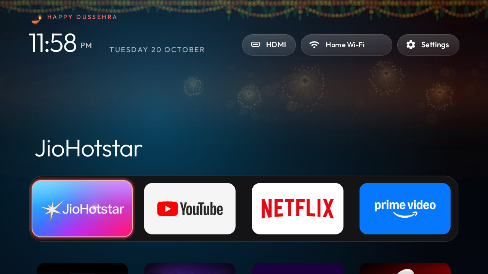
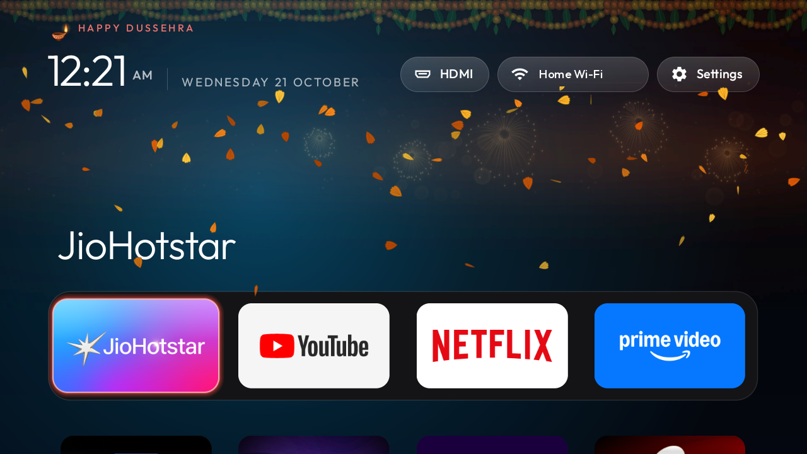
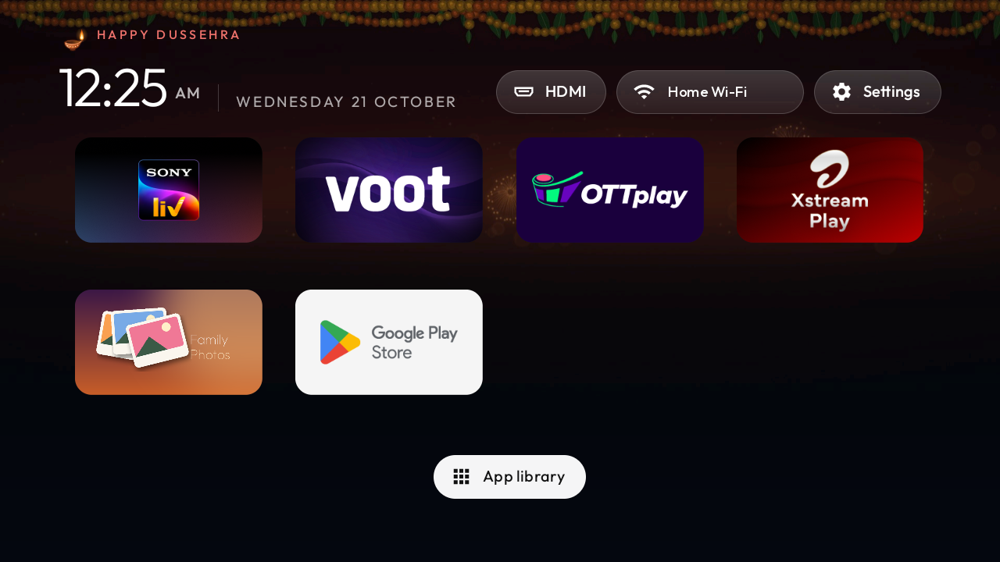
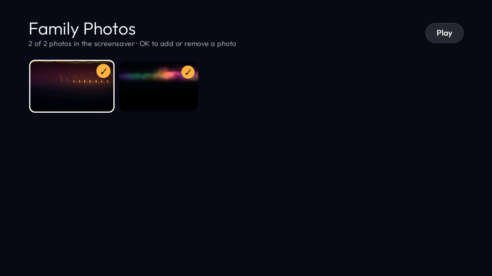

# TV Glowup

**Make a slow, cheap Android TV fast and beautiful in 10 minutes, over Wi-Fi. No root, nothing uninstalled, one command to undo.**

⭐ **Star this repo if it made your TV faster.** It helps other people with the same TV find it.



## Before / after

Measured with `./measure.sh` on a **OnePlus Y Series, 1 GB RAM, Android 11**, ~2 minutes after boot.

| | Before | After |
|---|---|---|
| Free RAM | 162 MB | **~265 MB** |
| Home screen RAM | 132 MB | **69 MB** |
| YouTube opens in | 2.9 s | **~1.5 s** |
| Netflix | 2.8 s | **~1.0 s** |
| JioHotstar | 5.5 s | **~2.3 s** |
| SonyLIV | 6.2 s | **~3.5 s** |
| Prime Video | no gain | no gain |

## What you get

- **Debloat with full restore.** Disables (never uninstalls) the preinstalled apps and Google extras that eat RAM. A full backup is taken first; `./restore.sh` puts everything back.
- **Apple-TV-style Home.** Big 4x2 grid of your apps, clock and date, nothing else. Light enough for 1 GB RAM.
- **Festival calendar, automatic.** Greetings, festival backgrounds and a Home-press animation (petals, fireworks...) for Diwali, Dussehra, Holi, Rakhi, Ganesh Chaturthi, Janmashtami, Lohri, Independence/Republic Day, Christmas and New Year, with a diya by the greeting. Dates through Jan 2028, from Drik Panchang. See all backgrounds: [docs/festivals.jpg](docs/festivals.jpg).
- **Family photo screensaver.** Your photos when the TV is idle, plus a **Family Photos** tile to pick which ones play.
- **Boots straight to Home**, even on MediaTek TVs that force Live TV at power-on.
- **HDMI / Wi-Fi / Settings pills** at the top: one click to switch input or open settings.
- **App library** to add or remove apps from Home.

| Home-press animation | All apps + App library | Family Photos picker |
|---|---|---|
|  |  |  |

## Quick start

You need a laptop on the same Wi-Fi as the TV, with `adb` (macOS: `brew install android-platform-tools`), Java 17 and the Android SDK to build the launcher (macOS: `brew install openjdk@17` and `brew install --cask android-commandlinetools`).

1. **On the TV:** Settings > Device Preferences > About > press OK on **Build** 7 times. Then Developer options > turn on **USB debugging** / **Network debugging**.
2. Note the TV's IP: Settings > Network & Internet > your Wi-Fi.
3. **On the laptop:**
   ```bash
   git clone https://github.com/sarthakgoel31/tv-glowup && cd tv-glowup
   export TV=192.168.x.x:5555     # your TV's IP
   ./install.sh
   ```
4. The TV asks **Allow USB debugging?** the first time: tick *Always allow*, press OK.

Press Home on the remote. Done.

Options: `DEVICE=none ./install.sh` skips the debloat (launcher only). `SHOW_WIFI_NAME=1` lets the Wi-Fi pill show your network name (it needs the location permission for that). `APK=app.apk` installs a prebuilt APK instead of building.

## Add your photos

```bash
pip3 install -r tools/requirements.txt
./add_photos.sh ~/Pictures/diwali-2026/*.jpg
```

Photos are turned upright, fitted to the screen (portrait photos are shown whole, never cropped) and **stripped of GPS location and all metadata** before they leave your laptop. Then open the **Family Photos** tile on the TV to choose which ones play.

## Make it yours

Edit `themes/india/config.json` and run `./install.sh` again:

| Key | What it does |
|---|---|
| `greeting_name` | Name after the greeting, e.g. `"Sharma Family"` shows *HAPPY DIWALI, SHARMA FAMILY*. Empty by default. |
| `dock_apps` | Apps in the top row, in order (package names). |
| `hidden_apps` | Apps never shown on Home. |
| `festival` | `"auto"` follows the calendar. |
| `reduced_motion` | `true` keeps animations light for slow TVs. |

Festival backgrounds are generated by `tools/wallgen/make_walls.py`; add your own as `themes/india/festivals/<id>.jpg`.

## Undo everything

```bash
./restore.sh
```

Re-enables every app, removes TV Glowup Home, and puts accessibility, screensaver and background-app settings back exactly as the first backup found them. Reboot the TV once after.

## Works on

| TV | Android | Status |
|---|---|---|
| OnePlus Y Series (1 GB RAM) | 11 | ✅ Tested |
| Other Android TV / Google TV | 9+ | Likely works. Use `DEVICE=none` or write your own list in `devices/`. At your own risk. |

Installed it on another TV? [Tell us here](../../issues/new?template=installed.yml) so it goes on this list.

## Safety

- **Nothing is uninstalled.** The debloat uses `pm disable-user`; every app can be turned back on with `pm enable` or `./restore.sh`. The full list, with what each app is, is in [devices/oneplus-y-series-android11/disable.txt](devices/oneplus-y-series-android11/disable.txt).
- **Backup first, always.** `install.sh` runs `backup.sh` before touching anything. Backups stay in `backups/` on your laptop.
- **Home is switched safely.** The new Home is installed and started first. The stock launcher is disabled only if it was the Home, and if Home doesn't end up on TV Glowup the stock launcher is put back.
- Nothing is sent anywhere. No accounts, no analytics.

## FAQ

**Why not root?** Rooting a TV voids the warranty, can brick it and blocks OTA updates. Everything here uses normal developer-mode `adb`, which Android allows on every TV.

**Will Netflix / Hotstar / YouTube still work?** Yes. Only apps in the debloat list are disabled; streaming apps you use are untouched.

**Did Prime Video get faster?** No. It's the one app that didn't improve in testing.

**A system update re-enabled some apps.** Run `./install.sh` again.

**The TV shows "Choose a Home app".** Pick TV Glowup Home and choose *Always*.

**How do I go back to the old home screen?** `./restore.sh`.

**Can I use it on Windows?** Run the scripts in Git Bash or WSL with `adb` on the PATH.

---

Made by Sarthak Goel to speed up his own OnePlus TV. MIT licensed, see [LICENSE](LICENSE) and [THIRD_PARTY_NOTICES.md](THIRD_PARTY_NOTICES.md).
